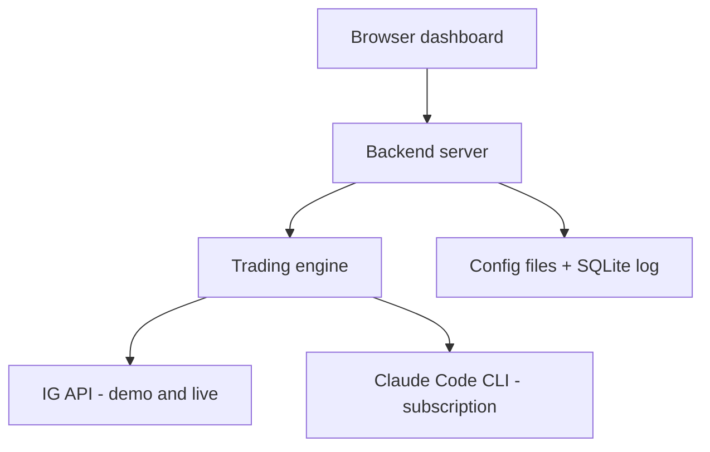
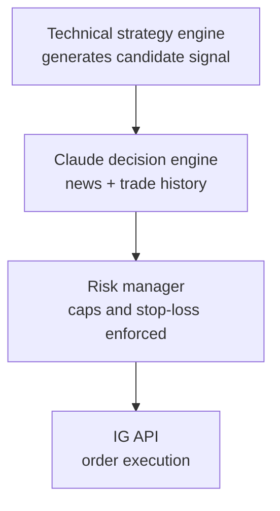

# IG Trading Bot — Design Specification

## 1. Overview

A web app that runs an automated trading bot against the IG Trading API. Key requirements:

- Trade across four asset classes: shares, indices, forex, commodities
- Switch between IG demo and live accounts without reconfiguring strategy settings
- Choose between **Auto trading** (the bot places orders itself) and **Manual trading** (the bot only shows a message: buy, sell, or do nothing; you place any trade yourself)
- Multiple simultaneous strategies, each combining multiple technical indicators
- Hard risk limits (max exposure, max per trade) and configurable stop-loss (fixed % or ATR-based dynamic)
- Every trade logged (price, P/L, indicators used, strategy, timestamp, mode)
- Claude integrated as the final trade decision-maker (news + trade history), a post-trade reviewer, a periodic performance reviewer, and a runtime bug monitor
- All configuration lives in separate JSON files so settings validated on demo carry over to live untouched

---

## 2. Architecture



**Components:**

- **Dashboard (browser)** — asset class picker, demo/live toggle with confirmation modal, Auto/Manual trading switch, manual trading signals panel, strategy/indicator config editor, live trade log view, P/L summary, Claude decision history, bug report review
- **Backend server** — hosts the trading engine and reads/writes the config files and SQLite database
- **Trading engine** — evaluates indicator strategies, calls Claude for a final decision, enforces risk limits, sends orders
- **Config files** — plain JSON, described in full below
- **SQLite log** — trades, periodic reviews, bug reports
- **IG API** — REST for orders and account data, streaming (Lightstreamer) for live prices; demo and live are separate base URLs and credentials
- **Claude (via the Claude Code CLI)** — final trade decisions (with its own web search for news), post-trade reviews, periodic batch reviews, runtime bug diagnosis. The bot runs Claude Code headless (`claude -p`) signed in with the user's Claude subscription. No Claude API key is used.

### Trade decision pipeline



In **Manual trading** the pipeline runs exactly the same up to the last step: Claude decides and the risk manager sizes the trade, but instead of sending the order the engine logs it as a suggestion and the dashboard shows the message:

- **BUY / SELL** — "You can BUY 0.24 of IX.D.FTSE.DAILY.IP at about 8001, stop 7761", with Claude's reasoning and news. The size and stop already respect the risk limits.
- **DO NOTHING** — Claude skipped the signal, or the risk manager rejected it, with the reason.

Nothing is sent to IG in manual mode. Positions the bot already opened in Auto mode are still tracked until they close.

**Manual trades are still logged.** When you place a suggested trade yourself on IG, the engine links it to the suggestion: it matches a new IG position to the newest open suggestion for the same instrument and direction, made in the 24 hours before the position was opened. The suggestion row then records the real deal, fill price, size and stop, and is tracked exactly like a bot trade (close, P/L, post-trade review, calibration). Each message also has **I placed it** / **Ignore** buttons, so the log shows which suggestions you followed. IG positions that match no suggestion are your own trades and are not logged.

Important: **the risk manager is never bypassed.** Claude decides direction and whether to trade at all; it cannot raise `max_per_trade`, `max_total_exposure`, or override the stop-loss method. Those limits are enforced downstream of every decision, regardless of source.

---

## 3. Configuration files

All configuration is plain JSON, checked into version control safely (real credentials are referenced via environment variables, never stored as plaintext). Demo and live share every file except `connection_config.json`, so a setting proven on demo carries over to live automatically.

### 3.1 `connection_config.json`

```json
{
  "active_mode": "demo",
  "execution_mode": "auto",
  "demo": {
    "api_key": "env:IG_DEMO_API_KEY",
    "username": "env:IG_DEMO_USERNAME",
    "password": "env:IG_DEMO_PASSWORD",
    "base_url": "https://demo-api.ig.com"
  },
  "live": {
    "api_key": "env:IG_LIVE_API_KEY",
    "username": "env:IG_LIVE_USERNAME",
    "password": "env:IG_LIVE_PASSWORD",
    "base_url": "https://api.ig.com"
  }
}
```

| Field | Meaning |
|---|---|
| `active_mode` | The single switch: `"demo"` or `"live"`. Every other module reads this to decide which credentials/URL to use. |
| `execution_mode` | `"auto"` (the bot places orders) or `"manual"` (advice only: buy, sell or do nothing). Set from the Auto/Manual switch in the dashboard header. Independent of `active_mode`, so manual trading works on demo or live. |
| `demo` / `live` | Separate credential blocks — IG issues a distinct API key and login per environment. |
| `api_key` | IG API key for that environment. |
| `username` / `password` | IG login for that environment. |
| `base_url` | `demo-api.ig.com` or `api.ig.com`. |

**Switching to live requires clearing the calibration gate** (see `live_promotion` in `claude_config.json`) and confirming a modal that reads back the current risk and strategy config before the switch takes effect.

### 3.2 `asset_config.json`

```json
{
  "enabled_classes": ["forex", "indices"],
  "instruments": {
    "forex": ["CS.D.EURUSD.CFD.IP"],
    "indices": ["IX.D.FTSE.DAILY.IP"],
    "shares": [],
    "commodities": []
  }
}
```

| Field | Meaning |
|---|---|
| `enabled_classes` | Which asset classes the bot is currently allowed to trade — controlled by the dashboard toggle. |
| `instruments.<class>` | IG "epics" (IG's own symbol codes) within each class that the bot watches. |

### 3.3 `indicator_config.json`

```json
{
  "strategies": {
    "forex_trend_momentum": {
      "timeframe": "15m",
      "indicators": [
        { "type": "ema", "role": "trend", "params": { "fast": 12, "slow": 26 } },
        { "type": "rsi", "role": "momentum", "params": { "period": 14, "overbought": 70, "oversold": 30 } },
        { "type": "atr", "id": "atr_stop", "role": "volatility", "params": { "period": 14 } }
      ],
      "entry_rules": [
        { "condition": "ema_fast_crosses_above_ema_slow" },
        { "condition": "rsi_below", "value": 70 }
      ],
      "rule_logic": "all",
      "stop_loss": {
        "mode": "atr_dynamic",
        "atr_source": "atr_stop",
        "atr_multiplier": 1.5
      }
    },
    "shares_breakout": {
      "timeframe": "1h",
      "indicators": [
        { "type": "bollinger", "params": { "period": 20, "std_dev": 2 } },
        { "type": "macd", "params": { "fast": 12, "slow": 26, "signal": 9 } }
      ],
      "entry_rules": [
        { "condition": "price_above_upper_band" },
        { "condition": "macd_bullish_cross" }
      ],
      "rule_logic": "all",
      "stop_loss": { "mode": "fixed_pct", "value": 3.0 }
    }
  },
  "asset_class_defaults": {
    "forex": "forex_trend_momentum",
    "shares": "shares_breakout",
    "indices": null,
    "commodities": null
  },
  "instrument_overrides": {
    "CS.D.EURUSD.CFD.IP": "forex_trend_momentum"
  }
}
```

| Field | Meaning |
|---|---|
| `strategies` | A named library of strategies, each self-contained (timeframe, indicators, entry rules, stop-loss), so multiple strategies run simultaneously across different instruments. |
| `strategies.<name>.timeframe` | Candle size this strategy evaluates on. |
| `strategies.<name>.indicators` | A list — any number, any mix. The engine loops over whatever's listed. |
| `indicators[].type` | Indicator to calculate: `ema`, `rsi`, `atr`, `macd`, `bollinger`, etc. |
| `indicators[].id` | Optional label so other parts of the strategy (like `stop_loss.atr_source`) can reference a specific indicator instance. |
| `indicators[].role` | Human-readable tag (`trend`, `momentum`, `volatility`) — documentation only, not used by logic. |
| `indicators[].params` | The indicator's own settings — periods, thresholds, multipliers. |
| `strategies.<name>.entry_rules` | Conditions evaluated against indicator values to decide entry. |
| `entry_rules[].condition` | A named condition the engine knows how to check. |
| `entry_rules[].value` | Threshold some conditions need; omitted where not needed. |
| `strategies.<name>.rule_logic` | `"all"` (every rule must be true) or `"any"` (at least one). |
| `strategies.<name>.stop_loss` | Optional — overrides `default_stop_loss` from `risk_config.json` for this strategy. |
| `stop_loss.mode` | `"fixed_pct"` or `"atr_dynamic"`. |
| `stop_loss.atr_source` | Which indicator `id` supplies the ATR value for a dynamic stop. |
| `stop_loss.atr_multiplier` | Multiplies ATR to get stop distance from entry price. |
| `asset_class_defaults` | Default strategy per asset class. `null` means that class won't trade even if enabled. |
| `instrument_overrides` | Maps a specific epic to a strategy different from its asset class default. |

### 3.4 `risk_config.json`

```json
{
  "max_total_exposure": 500.00,
  "max_per_trade": 100.00,
  "default_stop_loss": { "mode": "fixed_pct", "value": 2.0 },
  "take_profit_pct": null,
  "currency": "GBP"
}
```

| Field | Meaning |
|---|---|
| `max_total_exposure` | Hard ceiling on money committed across all open positions at once — never bypassed by any decision, including Claude's. |
| `max_per_trade` | Ceiling on a single position's size. |
| `default_stop_loss` | Fallback stop-loss method for any strategy that doesn't define its own `stop_loss` block. |
| `default_stop_loss.mode` | `"fixed_pct"` (percentage) by default — a predictable fallback. |
| `default_stop_loss.value` | Percentage used when mode is `"fixed_pct"`. |
| `take_profit_pct` | Percentage gain to auto-close and lock in profit. `null` disables it. |
| `currency` | Account currency, used for consistent display/logging. |

### 3.5 `claude_config.json`

```json
{
  "decision_engine": {
    "enabled": true,
    "run_on": ["demo", "live"],
    "news_source": "web_search",
    "news_lookback_hours": 24,
    "trade_history_lookback": 20,
    "min_confidence_to_trade": "medium",
    "model": "claude-sonnet-4-6"
  },
  "live_promotion": {
    "require_calibration": true,
    "min_demo_trades": 30,
    "min_demo_win_rate_pct": 55,
    "min_demo_days": 14,
    "manual_override_allowed": true
  },
  "post_trade_review": { "enabled": true, "run_on": ["demo", "live"] },
  "periodic_review": { "enabled": true, "frequency": "daily", "lookback_trades": 50, "run_on": ["live"] },
  "code_monitor": {
    "enabled": true,
    "watch": ["exceptions", "unexpected_order_rejections", "api_errors"],
    "trigger": "on_error",
    "notify": "dashboard_alert",
    "auto_apply_fixes": false
  }
}
```

| Field | Meaning |
|---|---|
| `decision_engine.run_on` | Demo and live both — lets you build a track record of how good Claude's calls are before it's deciding with real money. |
| `decision_engine.news_source` | `"web_search"` — Claude uses Claude Code's built-in WebSearch tool, not a separate news API. That's the only tool the decision session can use. |
| `decision_engine.model` | Model Claude Code runs (`--model`): a full name like `claude-sonnet-4-6`, or an alias like `sonnet`. Used for all four roles. |
| `decision_engine.trade_history_lookback` | How many past trades (on the relevant instrument/strategy) are included as context for each decision — this is how Claude "learns" from the log without any literal model training. |
| `decision_engine.min_confidence_to_trade` | Below this confidence, the engine treats Claude's verdict as "skip" rather than forcing a low-confidence trade. |
| `live_promotion.*` | The calibration gate — demo track record must clear these thresholds before switching to live is allowed without an explicit manual override. |
| `live_promotion.manual_override_allowed` | Whether the dashboard permits forcing the switch anyway, with a clear warning. |
| `code_monitor.watch` | Categories of runtime problems that get sent to Claude for diagnosis. |
| `code_monitor.trigger` | `"on_error"` — diagnosed immediately, not just on a schedule. |
| `code_monitor.auto_apply_fixes` | Deliberately `false` — Claude diagnoses and suggests, a human reviews and applies. No auto-patching of a live trading system. |

---

## 4. Database schema (SQLite)

```sql
CREATE TABLE trades (
    id INTEGER PRIMARY KEY AUTOINCREMENT,
    timestamp TEXT NOT NULL,
    mode TEXT NOT NULL,                     -- 'demo' or 'live'
    instrument TEXT NOT NULL,
    asset_class TEXT NOT NULL,
    strategy TEXT NOT NULL,
    indicator_suggested_direction TEXT,     -- what the technical strategy proposed
    claude_final_direction TEXT NOT NULL,   -- 'buy', 'sell', or 'skipped'
    claude_confidence TEXT,
    claude_reasoning TEXT,
    news_summary TEXT,                      -- brief note on news Claude weighed
    entry_price REAL,
    exit_price REAL,
    size REAL,
    stop_loss_used TEXT,                    -- JSON, e.g. {"mode":"atr_dynamic","atr_value":0.00021,"multiplier":1.5,"stop_price":1.1701}
    profit_loss REAL,
    indicators_used TEXT NOT NULL,          -- JSON blob of indicator values at decision time
    claude_post_trade_note TEXT,
    status TEXT,                            -- 'suggested' marks a manual-mode trade that was advised, not placed
    execution_mode TEXT,                    -- 'auto' or 'manual' when the signal was handled
    user_action TEXT                        -- manual suggestions: NULL (no answer), 'placed' or 'ignored'
);

CREATE TABLE claude_periodic_reviews (
    id INTEGER PRIMARY KEY AUTOINCREMENT,
    timestamp TEXT NOT NULL,
    period_start TEXT NOT NULL,
    period_end TEXT NOT NULL,
    trades_reviewed INTEGER NOT NULL,
    summary TEXT NOT NULL,
    flagged_issues TEXT                     -- JSON list, e.g. ["shares_breakout stop-loss may be too tight"]
);

CREATE TABLE claude_bug_reports (
    id INTEGER PRIMARY KEY AUTOINCREMENT,
    timestamp TEXT NOT NULL,
    trigger_type TEXT NOT NULL,             -- 'exception', 'order_rejection', 'api_error'
    error_summary TEXT NOT NULL,
    stack_trace TEXT,
    claude_diagnosis TEXT,
    claude_suggested_fix TEXT,
    status TEXT DEFAULT 'unreviewed'        -- 'unreviewed', 'acknowledged', 'fixed', 'dismissed'
);
```

A `trades` row where `claude_final_direction = 'skipped'` while `indicator_suggested_direction = 'buy'` is the key comparison for judging whether Claude's news-based judgment adds value: it's every case where the technical strategy wanted in and Claude said no.

---

## 5. Claude's four roles

1. **Decision engine (final say)** — for every candidate signal from the technical strategy engine, Claude receives the signal, searches the web for relevant news on that instrument, pulls recent trade history for that instrument/strategy from SQLite, and returns a final verdict: confirm the direction, reverse it, or skip. Runs on both demo and live.
2. **Post-trade review** — after each trade closes, Claude reviews that row and writes a short assessment into `claude_post_trade_note`.
3. **Periodic review** — on a schedule (daily by default), Claude reviews the last N trades as a batch, looking for patterns (which strategies are winning/losing, whether stop-loss settings seem off), stored in `claude_periodic_reviews`.
4. **Code/bug monitor** — watches for runtime exceptions, order rejections, and API errors during operation; on trigger, sends the error context to Claude for diagnosis, stored in `claude_bug_reports` for human review. No auto-patching.

### Calibration gate ("training" on demo, in practice)

Since Claude can't literally be retrained on your data, the demo-to-live pipeline works as a **gate on demo performance**, defined in `claude_config.json`:

- `min_demo_trades: 30` — at least 30 demo trades logged
- `min_demo_win_rate_pct: 55` — at least 55% profitable
- `min_demo_days: 14` — running for at least 14 days (avoids a lucky short streak clearing the gate)

Once all three are met, the dashboard allows switching `active_mode` to `"live"` (still behind the confirmation modal). `manual_override_allowed: true` means you can force it early if you choose, with a clear warning shown.

---

## 6. Open items before/while coding

- **Tech stack** — not yet decided. A reasonable starting point for this app: Python backend (FastAPI) for the trading engine, IG API calls, and Claude calls (now made through the Claude Code CLI); SQLite via a lightweight ORM (SQLModel/SQLAlchemy) for the log; a simple React or vanilla JS frontend for the dashboard. Worth confirming before writing code, since it affects how everything is scaffolded.
- **News search scope** — Claude uses its own web search; may be worth deciding search recency window and how many articles to summarize per decision, once you see real output quality.
- **ATR-based position sizing** — currently `max_per_trade` is a flat cap regardless of stop width. A natural v2 addition once dynamic stops are working: size the position so £-risk-per-trade stays constant even as the ATR-based stop distance varies.
- **Rule logic nesting** — `rule_logic` currently supports flat `"all"`/`"any"` only. If a strategy later needs mixed AND/OR (e.g. "A and (B or C)"), the schema will need nested rule groups.

---

*This document reflects the design as discussed; no code has been written yet.*
